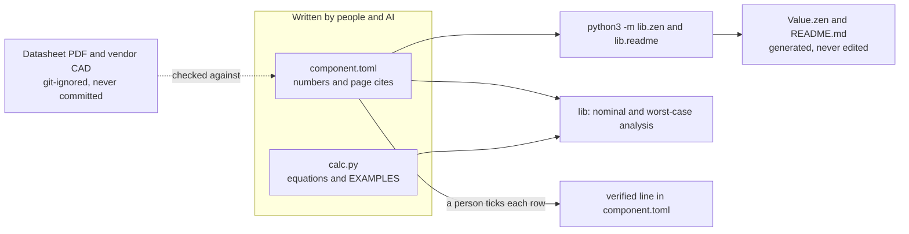

# Component library: datasheet numbers, equations, KiCad

[](https://github.com/kb1lqc/AgentEDA-Parts/actions/workflows/verify.yml) [](https://github.com/kb1lqc/AgentEDA-Parts/tags)

Each part is data (`component.toml`), datasheet math (`calc.py`), KiCad files, and a generated Zener wrapper for
the `pcb` circuit tool. Every number has a page cite; a person checks each one against the datasheet.



## Use a part

```python
from lib import load, Param, wca, table

ina = load("TexasInstruments/INA821IDGK")
rg = Param.tol(2.61, 0.001, "kohm")                                      # design choice
g = wca(ina.calc.gain, rg=rg)                                             # worst case over all min/max corners
vos = wca(ina.calc.vos_rti, unit="V", g=20.0, **ina.inputs("vos_rti"))
print(table([("Gain", g, ""), ("Offset (RTI)", vos, "full temperature")]))
```

`typ` is the function at every typ input. `min` and `max` are the lowest and highest results over all 2^n
combinations of input min and max. A missing bound is an error, never a guess.

Each part's README is its reference: every value with its cite, conditions and notes. A worked circuit analysis is in
`examples/current_sense.py`. Use only values from `component.toml` (through `part.param(key)` or `part.inputs(fn)`);
if a number you need is missing, say so rather than estimating it.

## Check a part (human)

Every number is checked by a person against the datasheet page image before it counts. Full steps:
[CONTRIBUTING.md](CONTRIBUTING.md#verify-parameters-the-human-check).

```sh
python3 tools/review.py INA229AIDGS                     # check one part
python3 tools/review.py --list-blocks                    # circuit blocks you can check
python3 tools/review.py --block INA229HighSideMonitor    # only the rows that block reads
```

- Run it in your own terminal. The page lists each row with its datasheet crop and one tick box.
- Tick a row only when it matches the page. Wrong: fix the TOML, run `python3 tools/verify.py --regen`. Unclear: leave it unticked and open an issue.
- `--block` and `--list-blocks` read the AgentEDA-Blocks repo: pass `--blocks-repo <path>` or set `CIRCUIT_BLOCKS`.

## Parts

Generated from each part's TOML by `python3 -m lib.readme`. "Status" counts the rows that matter that a person has
checked (see the [glossary](CONTRIBUTING.md#glossary)).

<!-- review-status:start -->
| Part | What | Status | Review command |
|---|---|---|---|
| [AnalogDevices/LTC4364MS](components/AnalogDevices/LTC4364MS/README.md) | Surge stopper with ideal diode, 4-80 V, MSOP-16 (MS); -1 latch-off or -2 auto-retry, C/I/H grade | released | `python3 tools/review.py LTC4364MS` |
| [Infineon/BSC040N10NS5](components/Infineon/BSC040N10NS5/README.md) | 100 V N-channel OptiMOS 5 power MOSFET, 136 A, 4.0 mohm max at VGS=10 V, PG-TDSON-8 (SuperSO8) | 0 of 17 | `python3 tools/review.py BSC040N10NS5` |
| [Infineon/ISC035N10NM5LF2](components/Infineon/ISC035N10NM5LF2/README.md) | 100 V N-channel OptiMOS 5 Linear FET 2 (hot swap / e-fuse), 164 A, 3.5 mohm max, PG-TDSON-8-59 | 16 of 22 | `python3 tools/review.py ISC035N10NM5LF2` |
| [Infineon/ISC750P10LM](components/Infineon/ISC750P10LM/README.md) | -100 V P-channel OptiMOS Power-Transistor, logic level, -32 A, 75 mohm max at VGS = -10 V, PG-TDSON-8 (SuperSO8) | 0 of 17 | `python3 tools/review.py ISC750P10LM` |
| [Murata/GCM155](components/Murata/GCM155/README.md) | Chip multilayer ceramic capacitors, X7R (R7) and C0G (5C), 1005M (0402), AEC-Q200 (GCM series) | 0 of 20 | `python3 tools/review.py GCM155` |
| [Murata/GCM188](components/Murata/GCM188/README.md) | Chip multilayer ceramic capacitors, X7R (R7) and C0G (5C), 1608M (0603), AEC-Q200 (GCM series) | 0 of 20 | `python3 tools/review.py GCM188` |
| [Murata/GCM216](components/Murata/GCM216/README.md) | Chip multilayer ceramic capacitors, X7R (R7) and C0G (5C), 2012M (0805), thickness 0.6 mm (code 6), AEC-Q200 (GCM series) | 0 of 16 | `python3 tools/review.py GCM216` |
| [Murata/GCM219](components/Murata/GCM219/README.md) | Chip multilayer ceramic capacitors, X7R (R7) and C0G (5C), 2012M (0805), thickness 0.85 mm (code 9), AEC-Q200 (GCM series) | 0 of 16 | `python3 tools/review.py GCM219` |
| [Murata/GCM21A](components/Murata/GCM21A/README.md) | Chip multilayer ceramic capacitors, X7R (R7) and C0G (5C), 2012M (0805), thickness 1.0 mm (code A), AEC-Q200 (GCM series) | 0 of 16 | `python3 tools/review.py GCM21A` |
| [Murata/GCM21B](components/Murata/GCM21B/README.md) | Chip multilayer ceramic capacitors, X7R (R7) and C0G (5C), 2012M (0805), thickness 1.25 mm (code B), AEC-Q200 (GCM series) | released | `python3 tools/review.py GCM21B` |
| [Murata/GCM319](components/Murata/GCM319/README.md) | Chip multilayer ceramic capacitors, C0G (5C), 3216M (1206), thickness 0.85 mm (code 9), AEC-Q200 (GCM series) | 0 of 15 | `python3 tools/review.py GCM319` |
| [Murata/GCM31A](components/Murata/GCM31A/README.md) | Chip multilayer ceramic capacitors, C0G (5C), 3216M (1206), thickness 1.0 mm (code A), AEC-Q200 (GCM series) | 0 of 15 | `python3 tools/review.py GCM31A` |
| [Murata/GCM31B](components/Murata/GCM31B/README.md) | Chip multilayer ceramic capacitors, C0G (5C) and X7R (R7), 3216M (1206), thickness 1.25 mm (code B), AEC-Q200 (GCM series) | 0 of 16 | `python3 tools/review.py GCM31B` |
| [Murata/GCM31C](components/Murata/GCM31C/README.md) | Chip multilayer ceramic capacitors, C0G (5C) and X7R (R7), 3216M (1206), thickness 1.6 mm (code C), AEC-Q200 (GCM series) | 0 of 23 | `python3 tools/review.py GCM31C` |
| [Murata/GCM31M](components/Murata/GCM31M/README.md) | Chip multilayer ceramic capacitors, C0G (5C) and X7R (R7), 3216M (1206), thickness 1.15 mm (code M), AEC-Q200 (GCM series) | 0 of 16 | `python3 tools/review.py GCM31M` |
| [Murata/GCM32D](components/Murata/GCM32D/README.md) | Chip multilayer ceramic capacitors, X7R (R7) and C0G (5C), 3225M (1210), thickness 2.0 mm (code D), AEC-Q200 (GCM series) | 0 of 20 | `python3 tools/review.py GCM32D` |
| [Murata/GCM32E](components/Murata/GCM32E/README.md) | Chip multilayer ceramic capacitors, X7R (R7) and C0G (5C), 3225M (1210), thickness 2.5 mm (code E), AEC-Q200 (GCM series) | 0 of 20 | `python3 tools/review.py GCM32E` |
| [Murata/GCM32Q](components/Murata/GCM32Q/README.md) | Chip multilayer ceramic capacitors, X7R (R7), 3225M (1210), thickness 1.5 mm (code Q), AEC-Q200 (GCM series) | released | `python3 tools/review.py GCM32Q` |
| [Panasonic/ERA-2AEB](components/Panasonic/ERA-2AEB/README.md) | 0402 (1005 metric) 0.063 W +/-0.1 % +/-25 ppm/degC thin film chip resistor, ERA-2AEB (47 to 100 k ohm, E24/E96) | 0 of 17 | `python3 tools/review.py ERA-2AEB` |
| [Panasonic/ERA-3AEB](components/Panasonic/ERA-3AEB/README.md) | 0603 (1608 metric) 0.1 W +/-0.1 % +/-25 ppm/degC thin film chip resistor, ERA-3AEB (47 to 330 k ohm, E24/E96) | 0 of 17 | `python3 tools/review.py ERA-3AEB` |
| [Panasonic/ERA-6AEB](components/Panasonic/ERA-6AEB/README.md) | 0805 (2012 metric) 0.125 W +/-0.1 % +/-25 ppm/degC thin film chip resistor, ERA-6AEB (47 to 1 M ohm, E24/E96) | 0 of 17 | `python3 tools/review.py ERA-6AEB` |
| [Panasonic/ERJ-2RKF](components/Panasonic/ERJ-2RKF/README.md) | 0402 (1005 metric) 0.1 W +/-1 % thick film chip resistor, ERJ-2RKF series (10 ohm to 1 Mohm, E24/E96) | 0 of 14 | `python3 tools/review.py ERJ-2RKF` |
| [Panasonic/ERJ-3EKF](components/Panasonic/ERJ-3EKF/README.md) | 0603 (1608 metric) 0.1 W +/-1 % thick film chip resistor, ERJ-3EKF series (10 ohm to 1 Mohm, E24/E96) | 4 of 14 | `python3 tools/review.py ERJ-3EKF` |
| [Panasonic/ERJ-6ENF](components/Panasonic/ERJ-6ENF/README.md) | 0805 (2012 metric) 0.125 W +/-1 % thick film chip resistor, ERJ-6ENF series (10 ohm to 2.2 Mohm, E24/E96) | 0 of 17 | `python3 tools/review.py ERJ-6ENF` |
| [Panasonic/ERJ-8ENF](components/Panasonic/ERJ-8ENF/README.md) | 1206 (3216 metric) 0.25 W +/-1 % thick film chip resistor, ERJ-8ENF series (10 ohm to 2.2 Mohm, E24/E96); NRFND | 0 of 17 | `python3 tools/review.py ERJ-8ENF` |
| [STMicroelectronics/STM32H723ZET6](components/STMicroelectronics/STM32H723ZET6/README.md) | Arm Cortex-M7 MCU, 550 MHz, 512 KB flash, LQFP144 (20 x 20 mm), -40 to 85 degC | 0 of 40 | `python3 tools/review.py STM32H723ZET6` |
| [STMicroelectronics/VNF1248F](components/STMicroelectronics/VNF1248F/README.md) | High-side switch controller with intelligent fuse protection, 6-60 V (70 V transient), AEC-Q100, QFN32L 5x5 mm | 0 of 35 | `python3 tools/review.py VNF1248F` |
| [TexasInstruments/INA229AIDGS](components/TexasInstruments/INA229AIDGS/README.md) | 85 V, 20-bit power/energy/charge monitor with SPI interface | released | `python3 tools/review.py INA229AIDGS` |
| [TexasInstruments/INA241DGK](components/TexasInstruments/INA241DGK/README.md) | Bidirectional current-sense amplifier, -5 V to 110 V common mode, 2.7 V to 20 V supply, VSSOP-8 (DGK) | 0 of 21 | `python3 tools/review.py INA241DGK` |
| [TexasInstruments/INA821IDGK](components/TexasInstruments/INA821IDGK/README.md) | Precision instrumentation amplifier, 4.5-36 V | 0 of 25 | `python3 tools/review.py INA821IDGK` |
| [TexasInstruments/TPS48000QDGXQ1](components/TexasInstruments/TPS48000QDGXQ1/README.md) | 100 V automotive low-IQ high-side driver with reverse polarity, short-circuit protection and diagnostics, VSSOP-19 (DGX), TPS4800-Q1 data sheet | 19 of 29 | `python3 tools/review.py TPS48000QDGXQ1` |
| [Vishay/WSK2512](components/Vishay/WSK2512/README.md) | 0.005 to 0.2 ohm (decade values) +/-0.1 % / +/-0.5 % / +/-1.0 % 1 W 4-terminal (Kelvin) Power Metal Strip current-sense resistor series, 2512 | 6 of 21 | `python3 tools/review.py WSK2512` |
| [Vishay/WSK2512-LOW](components/Vishay/WSK2512-LOW/README.md) | 0.0005 to 0.0049 ohm (decade values) +/-0.5 % / +/-1.0 % 1 W 4-terminal (Kelvin) Power Metal Strip current-sense resistor series, 2512 | 4 of 21 | `python3 tools/review.py WSK2512-LOW` |
| [Vishay/WSK2512R0250D](components/Vishay/WSK2512R0250D/README.md) | 0.025 ohm +/-0.5 % 1 W 4-terminal (Kelvin) Power Metal Strip current-sense resistor, 2512 | 0 of 23 | `python3 tools/review.py WSK2512R0250D` |
<!-- review-status:end -->

## Use in a Zener module

```zen
INA = Module("github.com/kb1lqc/AgentEDA-Parts/components/TexasInstruments/INA821IDGK/INA821IDGK.zen")
INA(name="U1", VS_P=Power("V15", voltage="15V 5%"), VS_N=Power("VN15", voltage="-15V 5%"),
    IN_P=Net("SNS_P", voltage="0V to 130mV"), IN_N=Net("SNS_N", voltage="0V"), RG1=Net("RG1"), RG2=Net("RG2"),
    REF=Net("REF", voltage="0V"), OUT=Net("VOUT"), ambient=ambient, derate=derate)
```

Run `pcb sync`. Every checked net needs a declared voltage range, or the build reports UNVERIFIED. Each part's README
lists which of its rows the wrapper checks ("Zener checks").

## Check

```sh
python3 tools/verify.py            # after every change: builds the parts you changed and runs every check
python3 tools/verify.py --all      # every part (what CI runs)
```

`verify.py` runs `lib.check`, `lib.zen`, `lib.readme`, the datasheet review check, `pcb build -Wstyle -Dwarnings` on each
part, and the unit tests. It prints one PASS line, or the first five failures and a log path.

## Contribute

- Add a part, check a part, release: [CONTRIBUTING.md](CONTRIBUTING.md)
- Data and equation format: [docs/SPEC.md](docs/SPEC.md). KiCad rules: [docs/KICAD.md](docs/KICAD.md).
- Datasheet numbers are checked by a person against the page image. Agents never stamp a row.
